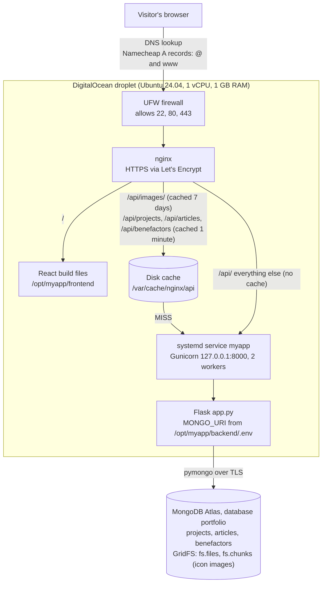

# jrenjq-website

> Production setup and deployment notes for **jrenjq.com**: a React frontend and Flask backend with MongoDB Atlas, served by nginx on a DigitalOcean droplet.


For details on the frontend or backend code specifically, see the related READMEs:

| README | Covers |
|---|---|
| [Frontend Implementation](frontend/README.md) | React components and styling |
| [Backend Implementation](backend/README.md) | Flask routes and data handling |

---

## Table of Contents
- [High Level Overview](#high-level-overview)
- [A. DigitalOcean Ubuntu Droplet First-time Setup](#a-digitalocean-ubuntu-droplet-first-time-setup)
- [B. Backend Scaffold (Flask)](#b-backend-scaffold-flask)
- [C. Frontend Scaffold (React)](#c-frontend-scaffold-react)
- [D. Simple CI/CD Shell Script](#d-simple-cicd-shell-script)
- [E. NGINX Configuration](#e-nginx-configuration)
- [F. Add Domain Name (jrenjq.com) to Droplet](#f-add-domain-name-jrenjqcom-to-droplet)
- [G. Frontend](#g-frontend)
- [H. Backend](#h-backend)
- [I. Cache via NGINX](#i-cache-via-nginx)
- [J. Troubleshooting](#j-troubleshooting)
- [K. Local development (WSL)](#k-local-development-wsl)

---

## High Level Overview



On a cache **HIT**, nginx answers straight from disk and the request never reaches Gunicorn.

### Paths used throughout

| What | Path on the droplet |
|---|---|
| Project root (the PROD git repo) | `/opt/myapp` |
| Frontend build files | `/opt/myapp/frontend` |
| Backend code and venv | `/opt/myapp/backend` |
| Backend secrets | `/opt/myapp/backend/.env` |
| nginx site config | `/etc/nginx/sites-available/myapp` |
| nginx cache config | `/etc/nginx/conf.d/api-cache.conf` |
| nginx cache storage | `/var/cache/nginx/api` |

> [!NOTE]
> Commands in this guide are run as `root` unless noted. If you set up a sudo user ([A.6](#6-optional-harden-ssh-non-root-sudo-user-key-only-login)), prefix them with `sudo`.

---

## A. DigitalOcean Ubuntu Droplet First-time Setup

| Setting | Value |
|---|---|
| OS | Ubuntu 24.04 (LTS) x64 |
| Plan | Basic |
| Resources | 1 vCPU / 1 GB RAM / 25 GB disk |

### 1. Check RAM and Disk
```bash
free -h    # RAM (and swap, if enabled)
df -h /    # disk size
```

### 2. Upgrade dependencies
```bash
apt update && apt upgrade -y
```

### 3. Add Swap File
```bash
fallocate -l 1G /swapfile    # create a file called /swapfile and reserve 1 GB of disk space for it
chmod 600 /swapfile          # only root can read/write it (swap can hold sensitive data from RAM)
mkswap /swapfile             # format the file as swap space (writes a header the kernel recognizes)
swapon /swapfile             # tell the kernel to start using it as swap right now
echo '/swapfile none swap sw 0 0' >> /etc/fstab    # append a line to /etc/fstab so swap turns on automatically after reboots

free -h    # the Swap row should show about 1.0Gi
```

### 4. Install Nginx, Python PIP & Venv, and UFW
```bash
apt install -y nginx python3-venv python3-pip ufw
```

### 5. UFW Configuration
```bash
ufw allow OpenSSH          # open port 22 so you can still log in over SSH (do this BEFORE enabling the firewall, or you could lock yourself out)
ufw allow 'Nginx Full'     # open ports 80 (HTTP) and 443 (HTTPS) so people can reach your website
ufw --force enable         # turn the firewall on; --force skips the "this may disrupt SSH connections, proceed?" prompt

ufw status    # should list OpenSSH and Nginx Full as ALLOW
```

### 6. (Optional) Harden SSH: non-root sudo user, key-only login
Running everything as root is fine to get started, but it is the usual gap in a first-time setup.
```bash
adduser deploy                                   # create a normal user
usermod -aG sudo deploy                          # let it use sudo
rsync --archive --chown=deploy:deploy ~/.ssh /home/deploy    # reuse your SSH key for the new user
```

> [!WARNING]
> **Open a second terminal and confirm `ssh deploy@YOUR_DROPLET_IP` works before continuing**, otherwise you can lock yourself out.

Then:
```bash
nano /etc/ssh/sshd_config
#   PermitRootLogin no
#   PasswordAuthentication no
systemctl restart ssh
```

---

## B. Backend Scaffold (Flask)

### 1. Install venv, flask, gunicorn
```bash
mkdir -p /opt/myapp/backend && cd /opt/myapp/backend
python3 -m venv venv
./venv/bin/pip install flask gunicorn
```

### 2. Create a placeholder `app.py`
It is replaced by the real backend later.
```bash
cat > app.py << 'EOF'
from flask import Flask, jsonify

app = Flask(__name__)

@app.route("/api/ping")
def ping():
    return jsonify(message="pong")
EOF
chown -R www-data:www-data /opt/myapp
```

### 3. Create the systemd service
This makes the backend run on boot and restart if it crashes.
```bash
cat > /etc/systemd/system/myapp.service << 'EOF'
[Unit]
Description=Flask app (gunicorn)
After=network.target

[Service]
User=www-data
Group=www-data
WorkingDirectory=/opt/myapp/backend
ExecStart=/opt/myapp/backend/venv/bin/gunicorn --workers 2 --bind 127.0.0.1:8000 app:app
Restart=always

[Install]
WantedBy=multi-user.target
EOF

systemctl daemon-reload
systemctl enable --now myapp
curl http://127.0.0.1:8000/api/ping    # should print {"message":"pong"}
```

**Changing the number of workers later.** The usual rule is (2 × CPU cores) + 1, but each worker uses roughly 30 to 60 MB of RAM, so 2 is safe on a 1 GB droplet. Edit the service file and change the number after `--workers`:
```bash
sudo nano /etc/systemd/system/myapp.service
sudo systemctl daemon-reload
sudo systemctl restart myapp
sudo systemctl status myapp
```

### 4. Install the real backend's dependencies
Once the real backend code is on the droplet (see [section D](#d-simple-cicd-shell-script)):
```bash
cd /opt/myapp/backend
source venv/bin/activate
python -m pip install -r requirements.txt
```
`requirements.txt` should include `flask`, `flask-cors`, `pymongo`, `python-dotenv` and `gunicorn`.

> [!TIP]
> Regenerate `requirements.txt` with `python -m pip freeze > requirements.txt` instead of editing it by hand. A typo such as `pymongo==4.20.0whi` makes the whole install fail.

### 5. Set up MongoDB Atlas
1. Create a free cluster at https://cloud.mongodb.com.
2. **Database Access**: create a database user with a strong password and `readWrite` access. If the password has special characters, URL-encode them inside the connection string.
3. **Network Access**: add the droplet's public IP (`curl -4 ifconfig.me` on the droplet). Add your laptop's IP too if you will seed from it. Some people allow `0.0.0.0/0` and rely on the password, which is less strict.
4. **Connect → Drivers**: copy the connection string, which looks like `mongodb+srv://<user>:<pass>@<cluster>/?retryWrites=true&w=majority`.

The database is named `portfolio`. Atlas creates it on first write.

### 6. Create the `.env` file (not in git)
`.env` is git-ignored, so it never arrives with `git pull`. Create it on the droplet by hand.

> [!IMPORTANT]
> Without `.env`, Gunicorn fails to start with `KeyError: 'MONGO_URI'` and nginx returns **502 Bad Gateway**.

```bash
nano /opt/myapp/backend/.env
```
```
MONGO_URI=mongodb+srv://<user>:<pass>@<cluster>/?retryWrites=true&w=majority
```
The service runs as `www-data`, so that user must be able to read the file:
```bash
chown www-data:www-data /opt/myapp/backend/.env
chmod 600 /opt/myapp/backend/.env
systemctl reset-failed myapp    # only needed if the service gave up after repeated failures
systemctl restart myapp
```

> [!CAUTION]
> Never paste the real URI into chat or commit it. If it is ever committed, rotate the database password.

### 7. Seed the database
`seed.py` and `seed_assets/` are excluded from the PROD sync, so run the seed from the dev machine (`jrenjq-website/backend`, venv active, `.env` pointing at Atlas):
```bash
python seed.py    # prints "done" at the end
```
- Each run wipes and refills the collections and the GridFS images. Don't run it after you start editing data directly in Atlas.
- A reseed creates **new image ids**. The nginx cache can hold the old project/article lists for up to 1 minute (see [I.5](#5-clear-the-cache) to clear it right away).

---

## C. Frontend Scaffold (React)

### 1. (On your own computer) Scaffold the React frontend with NPM
```bash
npm create vite@latest frontend -- --template react
cd frontend
npm install
```

### 2. Replace `src/App.jsx` with a test page
```jsx
import { useEffect, useState } from "react";

export default function App() {
  const [msg, setMsg] = useState("loading...");

  useEffect(() => {
    fetch("/api/ping")
      .then((r) => r.json())
      .then((d) => setMsg(d.message))
      .catch(() => setMsg("error"));
  }, []);

  return (
    <div>
      <h1>Hello world</h1>
      <p>Backend says: {msg}</p>
    </div>
  );
}
```

### 3. Build and upload
This is a one-time `scp`. After that, use [D. Simple CI/CD Shell Script](#d-simple-cicd-shell-script).
```bash
npm run build
ssh root@YOUR_DROPLET_IP "mkdir -p /opt/myapp/frontend"
scp -r dist/* root@YOUR_DROPLET_IP:/opt/myapp/frontend/
```

> [!IMPORTANT]
> Once the git-based deploy in [section D](#d-simple-cicd-shell-script) is set up, use that instead. Before doing the git setup, delete these hand-uploaded files (`rm -rf /opt/myapp/frontend/*`), otherwise `git pull` refuses to overwrite them.

---

## D. Simple CI/CD Shell Script

> See: https://github.com/jrenjq-dev/jrenjq-website-PROD

This repo is used to transfer the Flask backend and React build files from the development environment to production on the DigitalOcean droplet. The PROD repo contains `frontend/` and `backend/` at its root, so it is cloned into `/opt/myapp`.

### Deploy cheat sheet

| What changed | On the laptop | On the droplet |
|---|---|---|
| **Frontend** | `bash pushsync.sh` in `jrenjq-website/frontend` | `cd /opt/myapp && git pull --rebase` (nginx serves the new files straight away) |
| **Backend** | `bash pushsync.sh` in `jrenjq-website/backend` | `git pull`, then `python -m pip install -r requirements.txt` if dependencies changed, then `sudo systemctl restart myapp` |
| **nginx config** | n/a (config is not in git) | Edit on the droplet, then `sudo nginx -t && sudo systemctl reload nginx` |

### 1. Prerequisites

#### i. In the development environment (laptop)
You must have the development repo [jrenjq-website](https://github.com/jrenjq-dev/jrenjq-website) and [this repo](https://github.com/jrenjq-dev/jrenjq-website-PROD) side-by-side, named exactly:
```text
|--- jrenjq-website
|--- jrenjq-website-PROD
```
The PROD repo's `.gitignore` must contain:
```text
venv/
.env
__pycache__/
```

#### ii. In the production environment (DigitalOcean droplet)
Set up git in `/opt/myapp`, the directory that NGINX's `root` (`/opt/myapp/frontend`) sits in.
```bash
ssh-keygen -t ed25519 -C "droplet"       # accept the defaults
cat ~/.ssh/id_ed25519.pub                # add this as a Deploy key (read-only is enough) on the PROD repo in GitHub

cd /opt/myapp
git init
git remote add origin git@github.com:jrenjq-dev/jrenjq-website-PROD.git
git pull origin main                     # use your branch name if it isn't main
git branch --set-upstream-to=origin/main main
```
The folder is owned by `www-data` (from [B.2](#2-create-a-placeholder-apppy)) while you run git as root, so git may refuse with "detected dubious ownership". Fix it with:
```bash
git config --global --add safe.directory /opt/myapp
```

### 2. Instructions

#### i. Frontend
1. Go to the development repo `jrenjq-website/frontend` and run the script `pushsync.sh`.
    - This runs `npm run build`, copies over everything from `jrenjq-website/frontend/dist` (development repo) into `jrenjq-website-PROD/frontend` (production repo).
    - This pushes everything that's copied over into git.
2. Log into DigitalOcean and run `git pull --rebase` in `/opt/myapp`. Nothing else is needed: nginx serves the new files straight away.

#### ii. Backend
1. Go to the development repo `jrenjq-website/backend` and run the script `pushsync.sh`.
2. Log into DigitalOcean and run:
    ```bash
    cd /opt/myapp
    git pull
    cd backend && source venv/bin/activate
    python -m pip install -r requirements.txt    # only needed when dependencies changed
    sudo systemctl restart myapp                 # Gunicorn doesn't reload code on its own
    ```
    Check that the new code is live, for example `curl https://jrenjq.com/api/projects`.

#### iii. NGINX changes
The nginx config is not in git, so edit it on the droplet, then:
```bash
sudo nginx -t && sudo systemctl reload nginx
```

### 3. Shell script (Frontend): build and push build files only
```sh
#!/bin/bash
set -e    # stop immediately if any step fails

SRC_DIR="$(cd "$(dirname "$0")" && pwd)"    # folder this script lives in (the source repo)
PROD_DIR="$SRC_DIR/../../jrenjq-website-PROD/frontend"    # destination of build files 

# 1. commit and push source files to DEV repo, but only if something actually changed
git add -A
if git diff --cached --quiet; then
  echo "No changes to push to DEV."
else
  git commit -m "Pushed DEV frontend source files $(date '+%Y-%m-%d %H:%M:%S')"
  git push
fi

# 2. build
cd "$SRC_DIR"
npm run build

# 3. copy ONLY BUILD files into the prod repo
rm -rf "$PROD_DIR/assets"    # remove old hashed JS/CSS
cp -r dist/. "$PROD_DIR/"    # copy the new build in

# 4. commit and push build files to PROD repo, but only if something actually changed
cd "$PROD_DIR"
git add -A
if git diff --cached --quiet; then
  echo "No changes to push to PROD."
else
  git commit -m "Pushed PROD frontend build files $(date '+%Y-%m-%d %H:%M:%S')"
  git push
fi
```

### 4. Shell script (Backend): sync and push both DEV and PROD code
```sh
#!/bin/bash
set -e    # stop immediately if any step fails

SRC_DIR="$(cd "$(dirname "$0")" && pwd)"    # folder this script lives in (the source repo)
PROD_DIR="$SRC_DIR/../../jrenjq-website-PROD/backend"    # destination of sync files 

# 1. commit and push to DEV repo, but only if something actually changed
git add -A
if git diff --cached --quiet; then
  echo "No changes to push to DEV."
else
  git commit -m "Pushed DEV backend files $(date '+%Y-%m-%d %H:%M:%S')"
  git pull --rebase
  git push
fi

# 2. sync with prod repo, exclude things in DEV repo that don't need to be in PROD
#    (venv, caches, this script, the seed script + its images, and the .env secrets file)
rsync -a --delete --exclude='venv' --exclude='__pycache__' --exclude='pushsync.sh' --exclude='seed_assets' --exclude='seed.py' --exclude='.env' . "$PROD_DIR"

# 3. commit and push to PROD repo, but only if something actually changed
cd "$PROD_DIR"
git add -A
if git diff --cached --quiet; then
  echo "No changes to push to PROD."
else
  git commit -m "Pushed PROD backend files $(date '+%Y-%m-%d %H:%M:%S')"
  git pull --rebase
  git push
fi
```

> [!NOTE]
> `.gitignore` only affects `git add`. `rsync` ignores it and will copy `.env` into the PROD folder on your laptop unless it is excluded, which is why the script excludes it.

### 5. Rolling back a bad deploy
On the laptop, in `jrenjq-website-PROD`:
```bash
git revert HEAD        # creates a new commit that undoes the last one
git push
```
Then on the droplet run the usual steps: `git pull`, and for the backend `sudo systemctl restart myapp`.

---

## E. NGINX Configuration

### 1. Create the configuration file
> [!NOTE]
> `root` must be where the frontend build files are (`/opt/myapp/frontend`).

The proxy headers are set once at the `server` level and are inherited by every `location` below that doesn't set its own.
```bash
cat > /etc/nginx/sites-available/myapp << 'EOF'
server {
    listen 80 default_server;
    server_name _;

    root /opt/myapp/frontend;
    index index.html;

    # Proxy headers, set once and inherited by every location below
    proxy_set_header Host $host;                                   # domain the visitor used
    proxy_set_header X-Real-IP $remote_addr;                       # visitor's real IP
    proxy_set_header X-Forwarded-For $proxy_add_x_forwarded_for;   # visitor's IP, standard list form
    proxy_set_header X-Forwarded-Proto $scheme;                    # http or https

    location / {
        try_files $uri /index.html;
    }

    location /api/ {
        proxy_pass http://127.0.0.1:8000;    # to Gunicorn backend
    }
}
EOF
```

### 2. Enable the site and remove the default NGINX page
Create a symbolic link to the config file, then remove the default site:
```bash
ln -sf /etc/nginx/sites-available/myapp /etc/nginx/sites-enabled/myapp
rm -f /etc/nginx/sites-enabled/default
nginx -t && systemctl reload nginx
```

> [!NOTE]
> The nginx config files are not in git. See [I.7](#7-back-up-the-nginx-config) for keeping a backup.

---

## F. Add Domain Name (jrenjq.com) to Droplet

### 1. Point the domain at the droplet (Namecheap)

1. Log in to Namecheap, go to **Domain List**, and click **Manage** next to your domain.
2. Open the **Nameservers** setting and make sure it's **Namecheap BasicDNS** (the default). If you've changed it to something else, the records below won't take effect.
3. Go to the **Advanced DNS** tab and add these records. Delete any default parking-page records first, like the `URL Redirect` or the `CNAME` for `www` pointing to `parkingpage.namecheap.com`.

| Type | Host | Value | TTL |
|---|---|---|---|
| A Record | `@` | `YOUR_DROPLET_IP` | Automatic |
| A Record | `www` | `YOUR_DROPLET_IP` | Automatic |

`@` means the bare domain (`example.com`), and `www` covers `www.example.com`.

4. Check that it resolves before continuing (it can take a few minutes):
```bash
dig jrenjq.com +short        # should print YOUR_DROPLET_IP
dig www.jrenjq.com +short
```

### 2. Update nginx to use the domain
On the droplet, edit the `server_name` line:
```bash
sed -i 's/server_name _;/server_name jrenjq.com www.jrenjq.com;/' /etc/nginx/sites-available/myapp
nginx -t && systemctl reload nginx
```

> [!TIP]
> Optionally change `listen 80 default_server;` to `listen 80;` if you want nginx to only answer for your domain. Leaving it means requests by raw IP still work too, which is handy for testing.

### 3. Add HTTPS (free, with Let's Encrypt)
Wait until the domain resolves to your droplet, then:
```bash
apt install -y certbot python3-certbot-nginx
certbot --nginx -d jrenjq.com -d www.jrenjq.com
```

Certbot will:
- ask for your email,
- ask you to accept the terms,
- obtain the certificate and edit your nginx config to use it,
- offer to redirect HTTP to HTTPS (choose yes).

Certificates renew automatically. You can test that with:
```bash
certbot renew --dry-run
```

Certbot will update the NGINX configuration in `/etc/nginx/sites-available/myapp` to:
```nginx
server {
    server_name jrenjq.com www.jrenjq.com; # managed by Certbot

    root /opt/myapp/frontend;
    index index.html;

    # Proxy headers, set once and inherited by every location below
    proxy_set_header Host $host;
    proxy_set_header X-Real-IP $remote_addr;
    proxy_set_header X-Forwarded-For $proxy_add_x_forwarded_for;
    proxy_set_header X-Forwarded-Proto $scheme;

    location / {
        try_files $uri /index.html;
    }

    location /api/ {
        proxy_pass http://127.0.0.1:8000;
    }

    listen 443 ssl; # managed by Certbot
    ssl_certificate /etc/letsencrypt/live/jrenjq.com/fullchain.pem; # managed by Certbot
    ssl_certificate_key /etc/letsencrypt/live/jrenjq.com/privkey.pem; # managed by Certbot
    include /etc/letsencrypt/options-ssl-nginx.conf; # managed by Certbot
    ssl_dhparam /etc/letsencrypt/ssl-dhparams.pem; # managed by Certbot
}

server {
    if ($host = www.jrenjq.com) {
        return 301 https://$host$request_uri;
    } # managed by Certbot

    if ($host = jrenjq.com) {
        return 301 https://$host$request_uri;
    } # managed by Certbot

    listen 80;
    server_name jrenjq.com www.jrenjq.com;
    return 404; # managed by Certbot
}
```

---

## G. Frontend

A React single-page site built with Vite. The projects, articles and benefactors are not hardcoded: the page fetches them from the Flask API and renders them with reusable card components.

### Techniques used

| Technique | How it's used |
|---|---|
| **Pagination** | Lists show 5 cards per page, with arrow buttons, a page counter and hidden filler cards so the layout height stays stable |
| **Responsive design** | One 1024px breakpoint, applied in CSS media queries and in React through a `matchMedia` hook. On mobile, pagination is replaced by a "Load more" button |
| **CSS grid** | Equal-width grid columns keep the name and the two tag buttons centered on the page, even though the flag and buttons have different widths. Grids also lay out the social tiles and the mobile carousel |
| **Carousel** | The benefactors scroll sideways using CSS scroll-snap, in a random order on each page load, with arrows and page dots driven by the scroll position. On mobile it becomes two rows |
| **Loading states** | Icon skeletons that fade into the image, to cover the time the API images take to arrive |

### 1. Structure
```text
frontend/
├── vite.config.js            # dev-only proxy: /api → http://localhost:5000
└── src/
    ├── App.jsx               # page layout + useFetch for the three API lists
    ├── App.css               # page-level styles (intro, cards, socials, footer)
    ├── index.css             # global tokens (colors, fonts) + light/dark mode variables
    ├── assets/               # profile picture, logos, flag (card icons live in MongoDB, not here)
    └── components/
        ├── Card.jsx / Card.css            # one card, with a skeleton while its icon loads
        ├── ProjectCard.jsx                # blue card: "Try!" and "Code" buttons
        ├── ArticleCard.jsx                # purple card: "Link" button
        ├── PaginatedList.jsx / .css       # arrows on desktop, "Load more" on mobile
        └── BenefactorCarousel.jsx / .css  # shuffled scroll-snap carousel with dots
```

### 2. Implementation
> See: [Frontend README](frontend/README.md)

### 3. Build and Deploy
```bash
npm install
npm run dev        # local dev server with the /api proxy
bash pushsync.sh   # build and send build files to the PROD repo (then `git pull --rebase` in the project directory on the droplet)
```

---

## H. Backend

A Flask API that serves the site's content from MongoDB Atlas. It is read-only: it returns the project, article and benefactor lists as JSON, and the card icons as image bytes. Gunicorn runs it behind nginx on the droplet.

### Techniques used

| Technique | How it's used |
|---|---|
| **MongoDB with GridFS** | The lists are stored as documents in `portfolio` (`projects`, `articles`, `benefactors`). Icon images are stored in GridFS, and each card keeps the image's `ObjectId` as `icon_id` |
| **Serialization** | Each document is turned into JSON-friendly data, with `_id` renamed to `id` and `icon_id` converted into a URL such as `/api/images/<id>` |
| **Seeding** | `seed.py` fills the database and uploads the images from a list of entries, with an `order` field that keeps the display order. It is run from the dev machine and is not deployed |
| **Caching** | Images are sent with a one-year `immutable` Cache-Control header, which is safe because a reseed gives them new ids. nginx caches the images and lists on top of that, so most requests never reach Flask |
| **Configuration** | The database URI is read from `MONGO_URI` in a git-ignored `.env`, so no secrets live in the repo |

### 1. Structure
```text
backend/
├── app.py               # Flask routes
├── seed.py              # one-off: fills MongoDB from the lists in this file (not deployed)
├── seed_assets/         # icon images used by seed.py (not deployed)
├── requirements.txt
├── .env                 # MONGO_URI (git-ignored, created by hand on each machine)
└── venv/                # git-ignored
```
`seed.py`, `seed_assets/`, `.env`, `venv/` and `__pycache__/` are excluded by the `rsync` line in [D.4](#4-shell-script-backend-sync-and-push-both-dev-and-prod-code), so none of them reach the droplet through git.

### 2. Configuration
`.env` (see [B.6](#6-create-the-env-file-not-in-git) for the droplet):
```
MONGO_URI=mongodb+srv://<user>:<pass>@<cluster>/?retryWrites=true&w=majority
```
`app.py` connects with:
```python
db = MongoClient(os.environ["MONGO_URI"])["portfolio"]
fs = gridfs.GridFS(db)
```

> [!IMPORTANT]
> `"portfolio"` is the database name. `seed.py` and `app.py` must use the same name and the same URI, otherwise the seed fills one database and the API reads another, which returns `[]`.

### 3. Implementation
> See: [Backend README](backend/README.md)

### 4. Seeding
`seed.py` holds the projects, articles and benefactors as Python lists. Running it:
1. deletes the old `fs.files` and `fs.chunks`,
2. uploads each image from `seed_assets/` to GridFS,
3. empties and refills `projects`, `articles` and `benefactors`, with `order` following the list order.
```bash
cd backend && source venv/bin/activate
python seed.py        # prints "done"
```

> [!WARNING]
> Run it from your dev machine against Atlas. It wipes everything first.
> After a reseed, clear the nginx cache ([I.5](#5-clear-the-cache)) or wait about a minute for the old lists to expire.

To add or change an entry, edit the list in `seed.py` and reseed. To add a new image, put the file in `seed_assets/` and reference its filename as `icon_file`.

### 5. Run it
Development:
```bash
python app.py         # Flask debug server on http://127.0.0.1:5000
```
Production (what the systemd service runs):
```bash
gunicorn --workers 2 --bind 127.0.0.1:8000 app:app
```

> [!NOTE]
> `debug=True` in the `app.run(...)` line is ignored under Gunicorn, because Gunicorn imports the file and never runs the `if __name__ == "__main__"` block.

---

## I. Cache via NGINX

nginx caches the images and the JSON lists on disk, so repeat requests never reach Gunicorn. Without it, each icon is a Flask request and, with few workers, the icons queue up on the first visit.

| Path | Cached for |
|---|---|
| `/api/images/` | 7 days |
| `/api/projects`, `/api/articles`, `/api/benefactors` | 1 minute |
| Every other `/api/` URL | Not cached |

### 1. Set up the cache directory and config
nginx can't create `/var/cache/nginx` itself on this droplet (`mkdir() "/var/cache/nginx/api" failed`), so create it and give the nginx worker user ownership (`www-data` on Ubuntu; check with `grep -n "^user" /etc/nginx/nginx.conf`):
```bash
mkdir -p /var/cache/nginx/api
chown -R www-data:www-data /var/cache/nginx
```
Then create `/etc/nginx/conf.d/api-cache.conf`. Files in `conf.d/` are included inside the `http {}` block (check that `/etc/nginx/nginx.conf` has `include /etc/nginx/conf.d/*.conf;`), which is where `proxy_cache_path` must live:
```nginx
proxy_cache_path /var/cache/nginx/api      # folder where cached responses are saved as files
                 levels=1:2                # spread files over two levels of subfolders
                 keys_zone=apicache:10m    # name of the cache ("apicache") + 10 MB of memory for its index
                 max_size=100m             # max disk space; oldest-unused files are deleted past this
                 inactive=7d               # delete anything not requested for 7 days
                 use_temp_path=off;        # write straight into the cache folder
```
This only defines the storage. Nothing is cached until a `location` uses `proxy_cache apicache;`.

### 2. Add cache logic to the site's server block
Put this above the existing `/api/` location:
```nginx
location /api/images/ {
    proxy_pass http://127.0.0.1:8000;

    proxy_cache apicache;                                # turn on caching, using the zone defined in api-cache.conf
    proxy_cache_valid 200 7d;                            # keep successful responses 7 days (Flask's Cache-Control can override)
    proxy_cache_valid 404 1m;                            # keep "not found" 1 minute, so missing images don't hit Flask each time
    proxy_cache_lock on;                                 # if many visitors ask for the same uncached item, only one goes to Flask
    proxy_cache_use_stale error timeout updating;        # serve an expired copy if Flask is down or slow, or while it refreshes
    add_header X-Cache-Status $upstream_cache_status always;   # debug header: HIT, MISS, EXPIRED, STALE...
}

location ~ ^/api/(projects|articles|benefactors)$ {
    proxy_pass http://127.0.0.1:8000;

    proxy_cache apicache;
    proxy_cache_valid 200 1m;                            # lists are cached briefly, so edits show up within a minute
    proxy_cache_lock on;
    proxy_cache_use_stale error timeout updating;
    add_header X-Cache-Status $upstream_cache_status always;
}
```

> [!NOTE]
> `proxy_pass` has to be repeated in every location. The four `proxy_set_header` lines are not repeated here because the server-level ones are inherited (a location that sets its own `proxy_set_header` stops inheriting all of them).

The existing `location /api/ { proxy_pass ...; }` block must stay below these. It handles every other `/api/` URL.

### 3. Apply NGINX changes
```bash
sudo nginx -t && sudo systemctl reload nginx
```

### 4. Test changes
Run each command twice. The first response should say `MISS` and the second `HIT`:
```bash
curl -sI https://jrenjq.com/api/images/<id> | grep -i x-cache-status
curl -sI https://jrenjq.com/api/projects | grep -i x-cache-status
```
Take `<id>` from the `icon` field in `https://jrenjq.com/api/projects`. If a URL stays on `MISS`, check the response for `Set-Cookie` or `Cache-Control: no-store`, since either stops nginx from caching it.

### 5. Clear the cache
After a reseed, or when you want changes to show immediately:
```bash
sudo rm -rf /var/cache/nginx/api/*
```

### 6. Browser caching
The Flask image route sends `Cache-Control: public, max-age=31536000, immutable`, so each visitor downloads an icon once. This is safe because a reseed gives images new ids and therefore new URLs.

### 7. Back up the nginx config
The nginx files are not in git. Keep a copy outside `/etc/nginx`, because nginx loads every file in `conf.d/` and `sites-enabled/` (a stray `.bak` there would break it):
```bash
mkdir -p ~/nginx-backup
cp /etc/nginx/conf.d/api-cache.conf /etc/nginx/sites-available/myapp ~/nginx-backup/
```

---

## J. Troubleshooting

| Symptom | Where to look |
|---|---|
| **502 Bad Gateway** | nginx is up but Gunicorn isn't answering. Run `systemctl status myapp`, then `journalctl -u myapp -n 50 --no-pager` |
| `KeyError: 'MONGO_URI'` in the journal | `.env` is missing or unreadable by `www-data` ([B.6](#6-create-the-env-file-not-in-git)) |
| `ModuleNotFoundError` in the journal | Dependencies aren't installed in the venv ([B.4](#4-install-the-real-backends-dependencies)) |
| `Start request repeated too quickly` | Fix the cause, then `systemctl reset-failed myapp && systemctl restart myapp` |
| API returns `200` with `[]` | The database is empty, or the seed and the API use different databases or URIs ([B.7](#7-seed-the-database)) |
| Requests time out | The droplet's IP isn't in Atlas Network Access ([B.5](#5-set-up-mongodb-atlas)) |
| `nginx -t` fails: `mkdir() ... failed` | The cache directory is missing ([I.1](#1-set-up-the-cache-directory-and-config)) |
| `nginx -t` fails: zone `apicache` unknown | `/etc/nginx/conf.d/api-cache.conf` is missing or not included by `nginx.conf` |
| Images stay on `MISS` | Look for `Set-Cookie` or `Cache-Control: no-store` in the response ([I.4](#4-test-changes)) |
| `git pull` says "dubious ownership" | `git config --global --add safe.directory /opt/myapp` ([D.1.ii](#ii-in-the-production-environment-digitalocean-droplet)) |

Useful commands:
```bash
systemctl status myapp
journalctl -u myapp -n 50 --no-pager
tail -n 30 /var/log/nginx/error.log
free -h                                  # RAM left (look at the "available" column)
ps aux --sort=-%mem | head               # which processes use the most memory
ss -ltnp | grep 8000                     # is Gunicorn listening?
```

---

## K. Local development (WSL)

```bash
cd ~/jrenjq-website/backend
python3 -m venv venv
source venv/bin/activate
python -m pip install -r requirements.txt     # use "python -m pip", not bare "pip"
python app.py                                  # Flask on http://127.0.0.1:5000

# second terminal
cd ~/jrenjq-website/frontend
npm install
npm run dev                                    # Vite proxies /api to localhost:5000
```

- `backend/.env` needs `MONGO_URI` as well.
- Open the project from the WSL terminal with `code .` so VS Code runs inside WSL (bottom-left shows **WSL: Ubuntu**), then pick `backend/venv/bin/python` under **Python: Select Interpreter**.
- Ubuntu blocks system-wide `pip install` (`externally-managed-environment`). Always install inside the venv.
